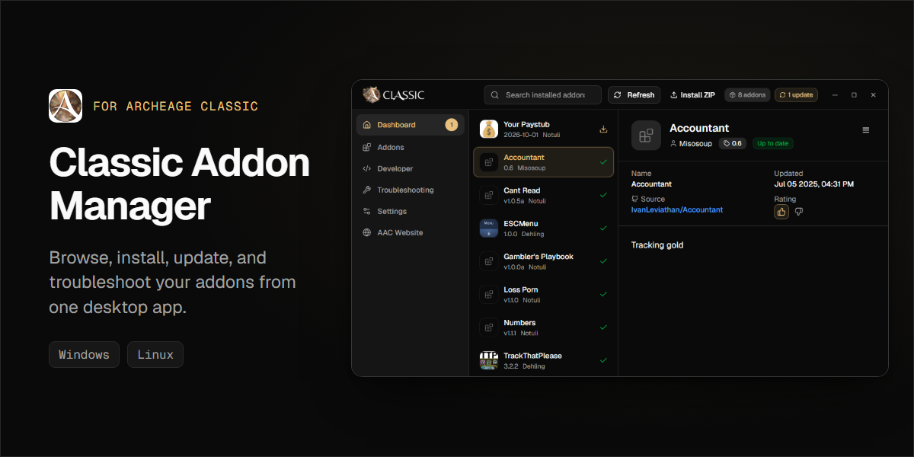
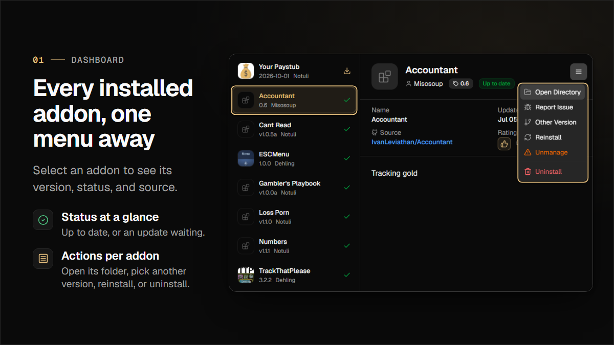
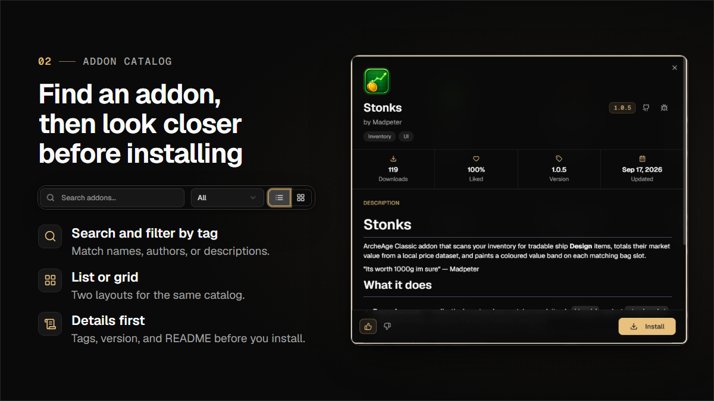
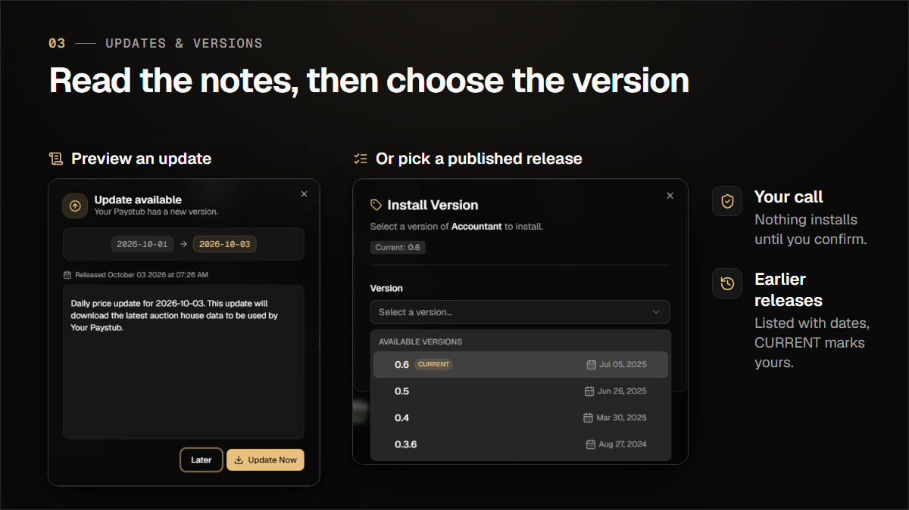
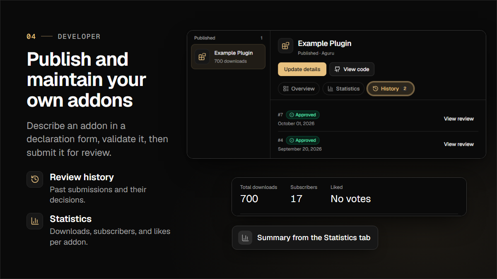
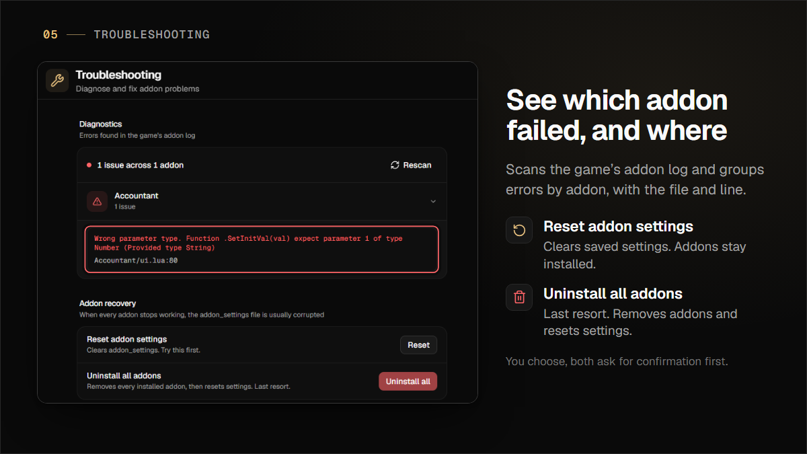
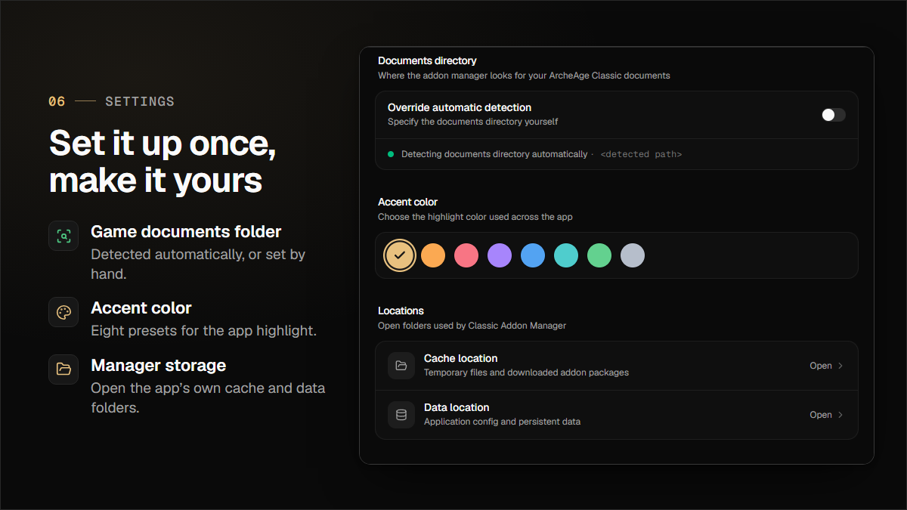

# Classic Addon Manager

A desktop application for managing addons in **ArcheAge**. Browse, install, update, and troubleshoot your addons all from one place.

[](https://ko-fi.com/gaijindev)

<p align="center">
  
</p>

---

## Feature Tour

### Manage installed addons

Select an addon to see its version, update status, and source, then open its folder, pick another version, reinstall, or uninstall from one menu.



### Discover new addons

Search the catalog, filter by tag, switch between list and grid, and read an addon's details before installing.



### Review updates and versions

Read release notes before updating, or choose a specific published release. Nothing installs until you confirm. Downloads are verified against their SHA-256 checksum before installing.



### Publish your own addons

Submit addons through a declaration form, follow each review decision, and track downloads, subscribers, and likes.



### Diagnose problems

Scan the game's addon log to see which addon raised an error and in which file and line. Recovery actions ask for confirmation.



### Personalize settings

Let the app detect your ArcheAge Classic documents folder, choose an accent color, and open the manager's cache and data folders.



---

## Download

You can get Classic Addon Manager in one of these ways:

- **ArcheAge launcher**: Click the **Addons** button in the launcher.
- **GitHub Releases**: Download `classic-addon-manager.exe` for Windows or the `.AppImage` for Linux from the [Releases page](https://github.com/classic-addon-manager/classic-addon-manager/releases).
- **In-app self-update**: The app notifies you when a new version is available. Windows executables and writable Linux AppImages can update themselves and restart automatically.

### Supported Platforms

- **Windows**: Full support (standalone `.exe`)
- **Linux**: Supported as an AppImage, but designed primarily for Windows. Some features may not work

### Data Locations

| Data                  | Windows                               | Linux                               |
|-----------------------|---------------------------------------|-------------------------------------|
| Config, login, `app.log` | `%APPDATA%\ClassicAddonManager`    | `~/.config/ClassicAddonManager`     |
| Cache                 | `%LOCALAPPDATA%\ClassicAddonManager`  | `~/.cache/ClassicAddonManager`      |

Set `CAM_CONFIG_DIR` and `CAM_CACHE_DIR` to override them, e.g. to sandbox a test run. With only `CAM_CONFIG_DIR` set, the cache goes to its `cache/` subdirectory.

### Headless Update Check

```
classic-addon-manager --check-updates
```

Checks installed addons for updates without opening a window. It logs to `check-updates.log` next to `app.log`.

---

## Support

If you find this project useful, consider supporting development:

[](https://ko-fi.com/X8X219OKGE)

---

## Development

### Requirements

- Rust 1.92+ (the newest `rust-version` among the dependencies)
- [`just`](https://github.com/casey/just) task runner (`cargo install just`)
- Windows only: the GNU toolchain (`rustup default stable-x86_64-pc-windows-gnu`) and the UCRT64 GCC toolchain from [MSYS2](https://www.msys2.org/), with `C:\msys64\ucrt64\bin` on `PATH`
- Linux only: a C toolchain, CMake, and the GPUI system libraries (see below)

Install the Linux build dependencies with your distribution's package manager:

```sh
# Debian / Ubuntu
sudo apt install build-essential clang cmake pkg-config libasound2-dev libfontconfig-dev libssl-dev \
    libwayland-dev libxcb1-dev libxkbcommon-dev libxkbcommon-x11-dev libzstd-dev

# Fedora
sudo dnf install gcc gcc-c++ make clang cmake pkgconf-pkg-config alsa-lib-devel fontconfig-devel openssl-devel \
    wayland-devel libxcb-devel libxkbcommon-devel libxkbcommon-x11-devel libzstd-devel

# Arch Linux
sudo pacman -S --needed base-devel clang cmake alsa-lib fontconfig openssl wayland libxcb libxkbcommon \
    libxkbcommon-x11 zstd
```

### Tasks

Run `just` to list all recipes.

| Command                | Purpose                                                                      |
|------------------------|------------------------------------------------------------------------------|
| `just build`           | Debug build                                                                  |
| `just build-prod`      | Optimized release build with `Cargo.lock` enforced                           |
| `just run [ARGS]`      | Build (debug) and run, e.g. `just run --check-updates`                       |
| `just run-prod [ARGS]` | Build (release) and run                                                      |
| `just dev`             | Rebuild and restart on source changes (needs `cargo-watch`)                  |
| `just check`           | Type-check all targets                                                       |
| `just test [ARGS]`     | Run the test suite, e.g. `just test -p cam_core` for the GPUI-free core only |
| `just lint`            | Clippy, warnings are errors                                                  |
| `just fmt`             | Format the sources                                                           |
| `just fmt-check`       | Check formatting without changing files                                      |
| `just ci`              | `fmt-check`, `lint`, and `test`                                              |
| `just clean`           | Remove build artifacts                                                       |

### Live Development

Run `just dev` (install the watcher with `cargo install cargo-watch`). It rebuilds and restarts the app whenever `crates/` or `Cargo.toml` changes.

Debug builds include the GPUI inspector: press **Ctrl+Shift+I** to open or close it and pick an element to see the source location that rendered it.

### Building

To build a production binary:

```
just build-prod
```

The binary is written to `target/release/classic-addon-manager` (`.exe` on Windows). Release builds keep the symbol table so panic backtraces in `app.log` show function names, which is why Windows builds use the GNU toolchain: MSVC only writes symbols to a `.pdb` file. Windows builds embed the application icon from `crates/classic-addon-manager/resources/windows/` (its `build.rs`) and only depend on DLLs that ship with Windows 10 and later.

To build a Linux AppImage, run `just appimage` on Linux. It builds inside an Ubuntu 22.04 container (Podman, or Docker if Podman is missing, override with `CONTAINER_ENGINE`) so the binary runs on glibc 2.35 and newer, and writes `dist/classic-addon-manager-<architecture>.AppImage`. The container build uses its own `target/appimage/` directory.

### Version Management

Use the `version` recipe instead of editing version numbers by hand. It updates `[workspace.package] version` in the root `Cargo.toml`, which every crate inherits, and refreshes `Cargo.lock`.

```
# Set an explicit version
just version 4.1.0

# Bump to the next version (defaults to patch)
just version major
just version minor
just version patch
```

An explicit version accepts `X.Y.Z` or `vX.Y.Z`. Run the recipe from the project root.

### Asset Generators

| Command                     | Purpose                                                                                                                                                         |
|-----------------------------|-----------------------------------------------------------------------------------------------------------------------------------------------------------------|
| `just gen icons <names...>` | Copy Lucide icons into `crates/cam_ui/assets/icons`, e.g. `just gen icons circle-check RefreshCw close=x`. Downloads `lucide-static` into a temporary directory |

### Project Structure

A Cargo workspace with one crate per layer. A crate only depends on the ones above it in this table, so the compiler keeps the layers apart:

| Crate                           | Description                                                                                                                                             |
|---------------------------------|---------------------------------------------------------------------------------------------------------------------------------------------------------|
| `crates/cam_core/`              | Everything that is not UI, without GPUI: addons, the server API (catalog, developer, AI chat), auth, config, self-updater, single-instance IPC, logging |
| `crates/cam_ui/`                | The widget kit on gpui-kit: theme, Lucide icons and Geist fonts (`assets/`), components, Markdown rendering, toasts                                     |
| `crates/classic-addon-manager/` | The app: `main.rs`, GPUI state (`state/`), and the window (`ui/`: shell, pages, chat). Owns the images in `assets/` and the Windows resources           |

| Directory | Description                                         |
|-----------|-----------------------------------------------------|
| `tools/`  | Version tool, asset generators, AppImage packaging  |
| `docs/`   | README screenshots                                  |

### Tech Stack

- **UI framework:** GPUI via `gpui-kit`
- **Fonts:** Geist + Geist Mono
- **HTTP:** ureq
- **Config:** TOML (serde)
- **Markdown/README rendering:** markdown, html5ever
- **Packaging:** standalone executable (Windows), AppImage via appimagetool (Linux)
